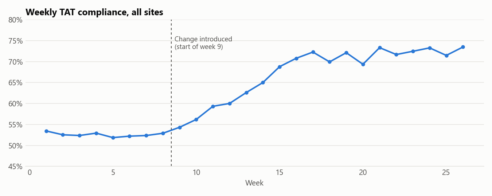
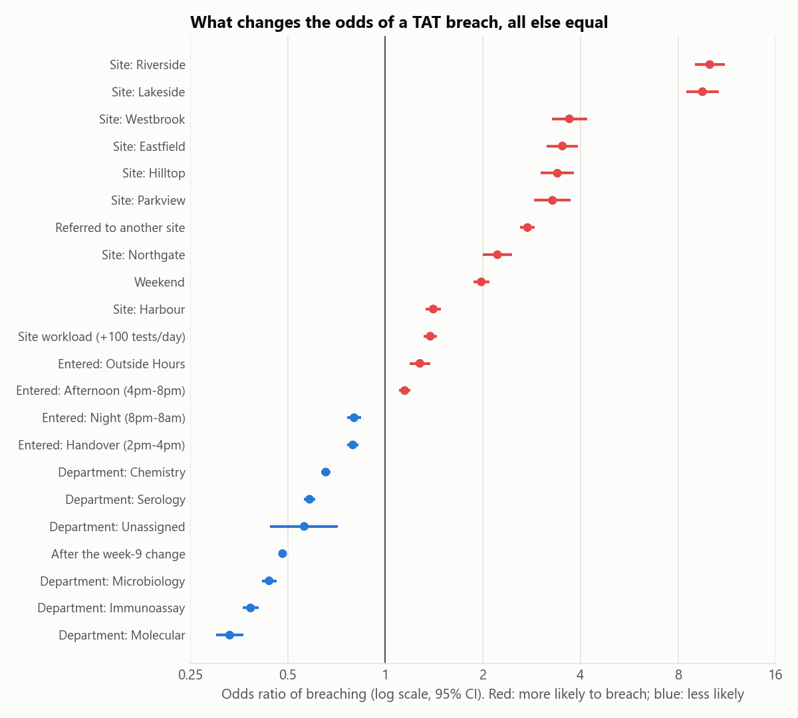

# What drives lab turnaround-time breaches? A Python and statistics study

> **In short:** Labs promise each result within a set time, and a result that arrives late is called a "breach". Using six months of simulated lab data (modelled on how real labs work, with no real patient information), I worked out what makes results late and whether a process change actually helped.
>
> It did help, more than the trend before it would explain. Two short-staffed sites caused a quarter of all late results, and staffing them properly would prevent about 139 late results a week. **What it shows:** I go beyond describing what happened to explaining why, and I put a number on the fix.

A diagnostic lab promises each result within a target time (turnaround time, or TAT). This project takes six months of test-level records from a nine-site lab network, about 110,000 tests, and asks which factors make a result late, whether a process change actually worked, and where fixing staffing would help most.

**Tools:** Python, pandas, statsmodels (logistic regression, segmented regression with Newey-West errors), SciPy (chi-square), matplotlib.

**[Open the notebook →](analysis.ipynb)**

> **The data is synthetic.** I work with real lab TAT data, which can't be published. `generator/generate_lab_data.py` simulates a lab network with the same structure as a real LIS export: opening hours, courier runs between sites, batch-run departments, bench queues that grow with workload, instrument downtime, short-staffed sites and a process change in week 9. Site names, volumes and timings are invented. The point of this repository is the method.



## Findings

**1. The week-9 change worked, and it wasn't an existing trend.** Compliance averaged 53% in weeks 1–8 and 72% in weeks 17–26. Segmented regression shows the pre-change trend was flat (−0.07 points a week, p = 0.24); after the change it rose by 1.12 points a week (95% CI 0.78 to 1.47). A simple before/after comparison could not have ruled out a trend that was already under way.

**2. Two short-staffed sites produce a quarter of all breaches.** Holding test type, shift, weekday, workload and referral constant, a test performed at Riverside or Lakeside has about 10 times the odds of breaching as the same test at the main hub. Together they handle 14% of tests and account for 25% of breaches.



**3. Across all sites, four other things raise the odds of a breach:** being referred to another site (×2.75), weekends (×1.98), every extra 100 tests a site handles that day (×1.38), and being entered outside opening hours (×1.28). Every interval excludes 1.

**4. Fixing staffing at those two sites is worth about 139 breaches a week.** Using the fitted model to re-score their tests as if they ran like a fully staffed site of similar size removes 9% of all network breaches.

**5. Breaches also became less serious.** Severe and critical breaches (more than 3 hours over target) fell from 50% to 42% of all breaches after the change (chi-square, p < 0.001).

## How it was done

| Step | Method | Why |
|---|---|---|
| Scoring | Excluded 1,537 tests that were never verified, had no target, or showed a zero TAT | Counting unmeasurable tests as failures, or zero-TAT artefacts as passes, distorts compliance |
| Did the change work? | Interrupted time series: `compliance ~ week + post + weeks_since`, HAC standard errors | Separates a change in level or slope from a pre-existing trend; weekly data is autocorrelated |
| What drives breaches? | Logistic regression with site, department, entry shift, weekend, referral, daily site workload and period | Raw breach rates by site are confounded by test mix and timing |
| Where to act | Counterfactual prediction from the fitted model | Turns odds ratios into breaches a week, which is what a manager can plan around |
| Severity | Overrun bands (marginal, moderate, severe, critical) and a chi-square test on the before/after mix | A late result 20 minutes over and one 20 hours over need different responses |

One result that looks wrong at first: samples entered during the 2pm–4pm handover are *less* likely to breach than morning ones. The handover delay applies to work being **finished** in that window, and that work mostly started in the morning. The notebook explains why the export can't measure completion shift directly.

## Limits

- Simulated data: effect sizes reflect the generator's assumptions.
- The model is associational. Staffing can't be separated from anything else that differs between sites.
- There is no control group for the week-9 change, so a network-wide shock at the same time would look like an effect.
- On real data I would add site-level random effects and check the model's calibration before using the counterfactual for planning.

## Reproduce

```bash
pip install -r requirements.txt
python generator/generate_lab_data.py   # writes data/ (and weekly LIS-style workbooks to exports/)
python build_notebook.py                # writes and runs analysis.ipynb, saves figures/
```

The generator is seeded, so the same data and numbers come out every time.

```
generator/generate_lab_data.py  the simulation (process rules are documented at the top)
data/tests.csv                  one row per test, 111,398 rows
data/reference_times.csv        test catalogue with target TATs
data/sites.csv                  site attributes
build_notebook.py               builds analysis.ipynb from code so the notebook can't drift
analysis.ipynb                  the analysis, with outputs
```

The same synthetic data feeds my [TAT platform demo](https://github.com/Yusuf-Tiamiyu/lab-tat-platform-demo) and [Power BI lab operations kit](https://github.com/Yusuf-Tiamiyu/lab-operations-powerbi).
